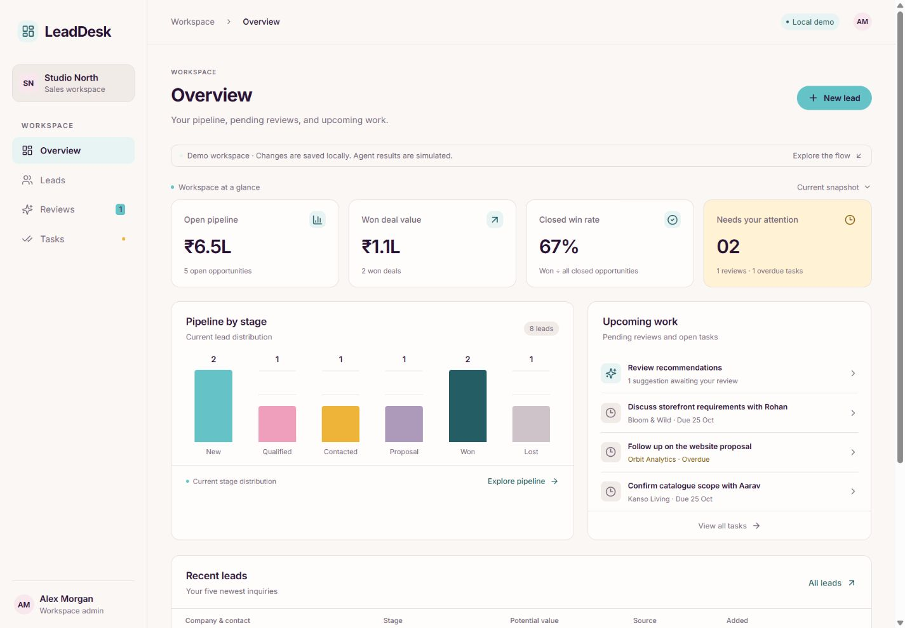
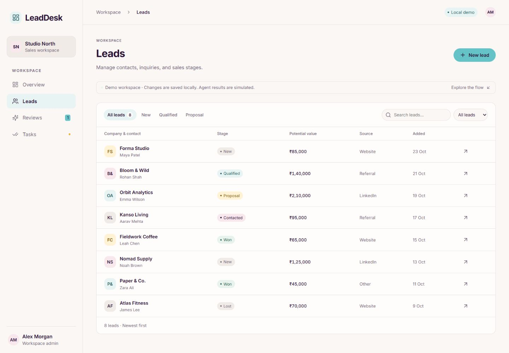
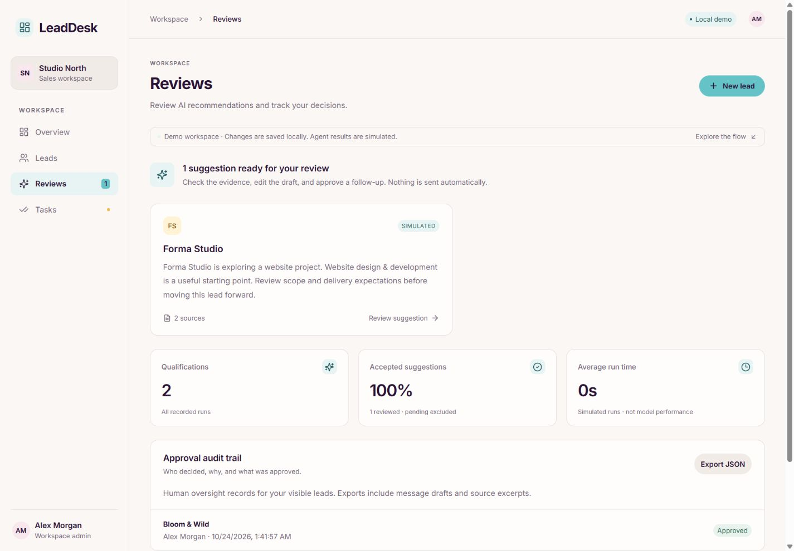
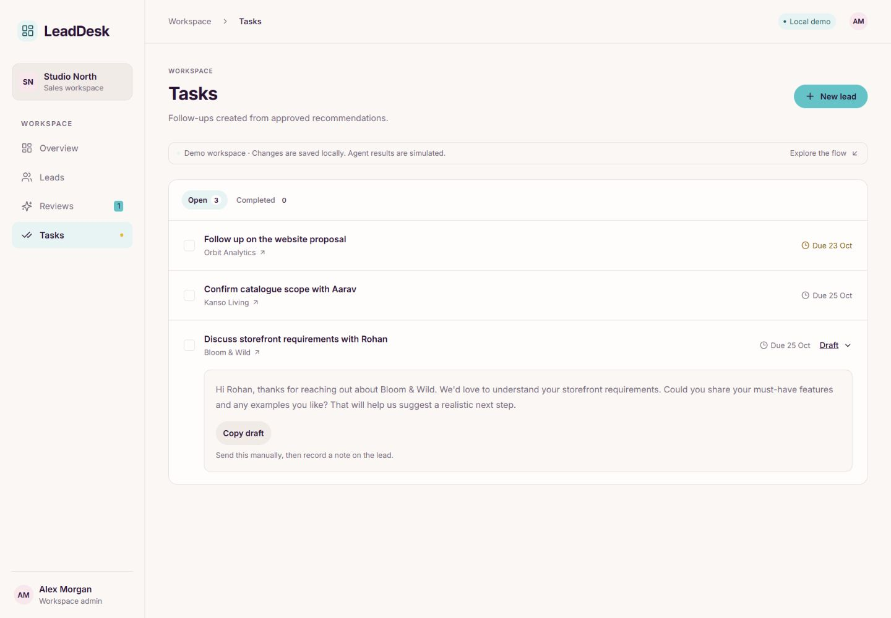
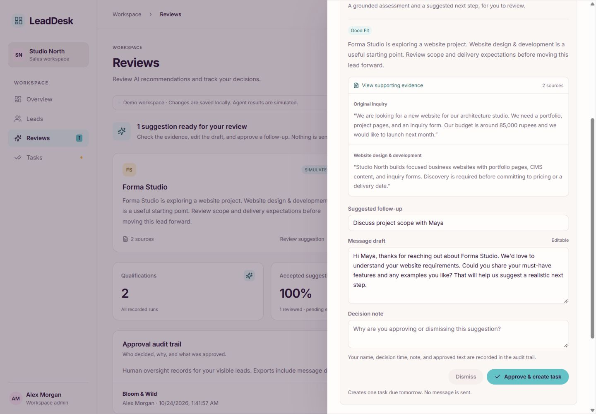
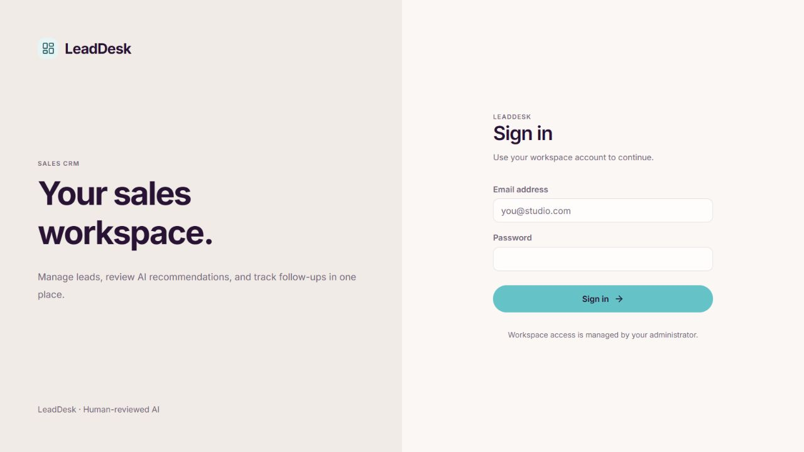
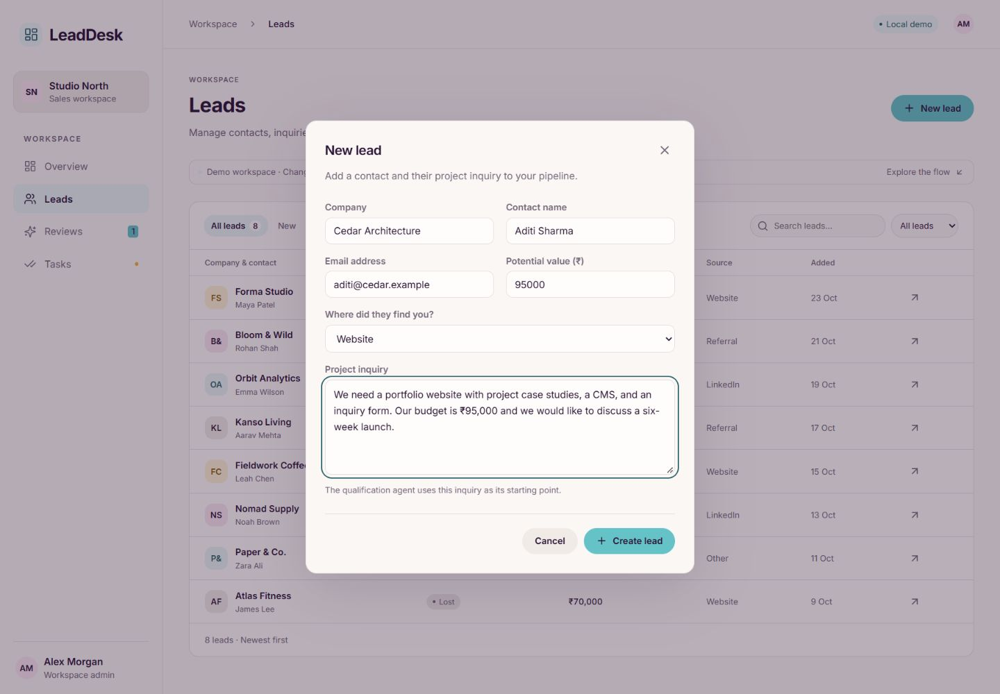
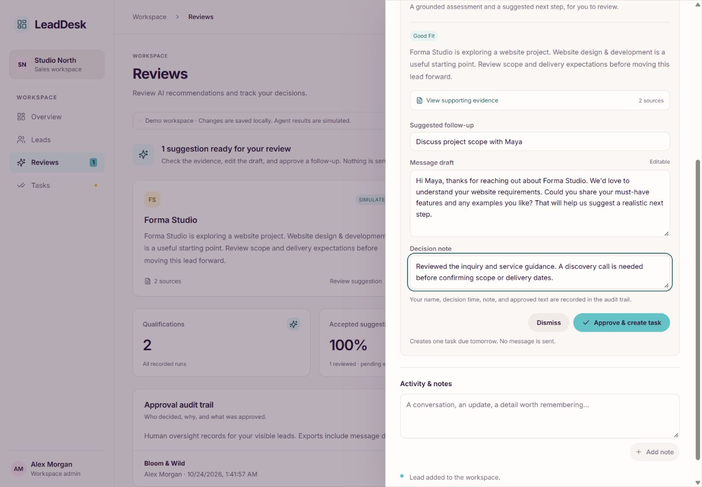
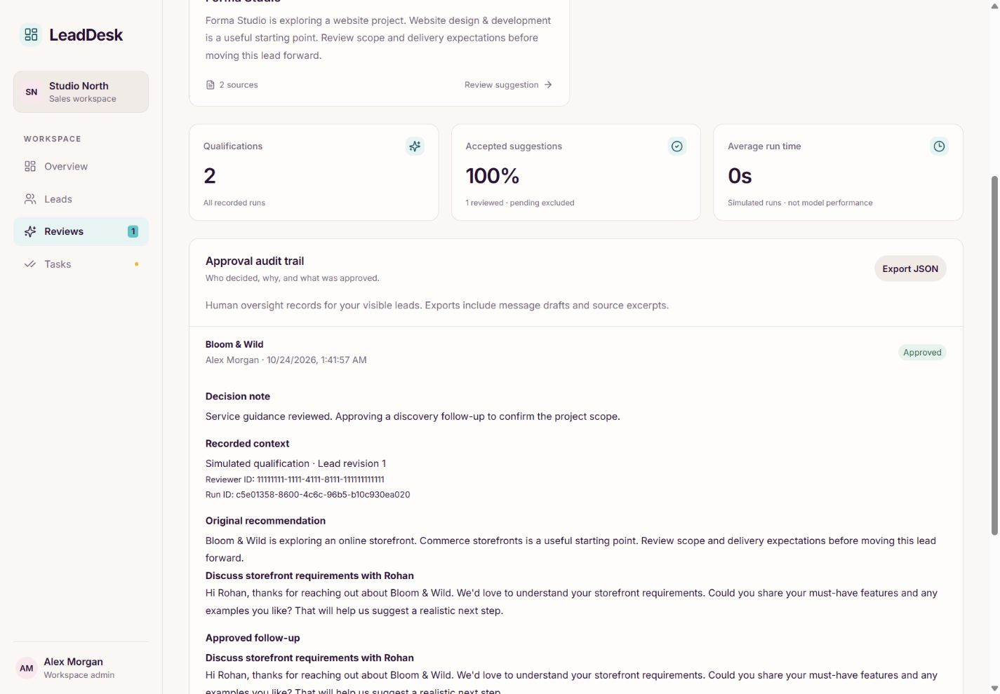
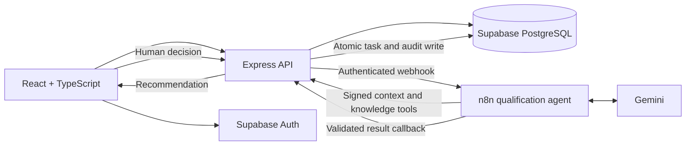

# LeadDesk

### Agent-assisted lead qualification with human approval and decision traceability

[](https://github.com/tusharg007/LeadDesk/actions/workflows/ci.yml)

LeadDesk is a full-stack CRM for a small service business. It turns project inquiries into evidence-backed qualification recommendations and reviewable follow-up tasks. A tool-using n8n/Gemini agent performs the initial assessment; the salesperson checks the sources, edits the draft, and decides what happens next.

**React · TypeScript · Express · Supabase PostgreSQL/Auth · n8n · Gemini · Docker**

[Live application](https://leaddesk-kxgh.onrender.com/) · [Setup guide](docs/SETUP.md) · [Agent workflow](n8n/README.md) · [Verification notes](docs/PORTFOLIO.md)

> **Demo access:** The hosted application requires a provisioned workspace account. Explore the complete local demo without credentials or API keys using the quick start below. Live AI qualification requires the local n8n instance and webhook tunnel to be online; the manual CRM works independently.



## The problem

Sales inquiries arrive with incomplete requirements, uncertain budgets, and delivery expectations that need clarification. A useful CRM should help a salesperson decide the next step while keeping the original inquiry, service guidance, and final decision connected.

LeadDesk implements one complete workflow:

**Capture an inquiry → qualify against service knowledge → review evidence and draft → approve or dismiss → complete the follow-up.**

## Product features

| Area                 | Implemented behavior                                                                                                                                               |
| -------------------- | ------------------------------------------------------------------------------------------------------------------------------------------------------------------ |
| **Overview**         | Open pipeline value, won deal value, closed win rate, stage distribution, pending reviews, and overdue tasks with drill-through navigation.                        |
| **Leads**            | Create contacts and inquiries, search and filter stages, update the pipeline, and record activity notes.                                                           |
| **Qualification**    | A bounded agent reads scoped lead context, searches curated service knowledge, and proposes an assessment, missing details, cited excerpts, and a follow-up draft. |
| **Reviews**          | Inspect evidence, edit the task title and message, and approve or dismiss with a mandatory decision note.                                                          |
| **Tasks**            | Track approved follow-ups, copy message drafts, and complete or reopen tasks. Approval creates a task; it does not send a message.                                 |
| **Decision audit**   | Record the authenticated reviewer, timestamp, reason, original recommendation, and approved wording, with scoped JSON export.                                      |
| **Workspace access** | Supabase sign-in, workspace isolation, owner-scoped sales access, and workspace-wide admin visibility.                                                             |

The responsive interface uses a consistent Cupcake-inspired palette across pages, forms, and dialogs.

## Screenshots

These screenshots show the implemented interface with **synthetic local demo data**. Simulated recommendations and metrics are labeled in the UI; they are not model performance results. Select an image to view it at full size.

| Leads                                                                                                                | Reviews                                                                                                                                                 |
| -------------------------------------------------------------------------------------------------------------------- | ------------------------------------------------------------------------------------------------------------------------------------------------------- |
| [](docs/screenshots/leads.jpg)            | [](docs/screenshots/reviews.jpg)                           |
| **Tasks**                                                                                                            | **Qualification evidence**                                                                                                                              |
| [](docs/screenshots/tasks.jpg) | [](docs/screenshots/qualification.jpg) |

<details>
<summary>More screens: sign-in, lead creation, human approval, and audit detail</summary>

### Workspace sign-in



### Lead creation



### Human review



### Approval audit trail



</details>

## Architecture



| Layer                | Technology and responsibility                                                                             |
| -------------------- | --------------------------------------------------------------------------------------------------------- |
| Frontend             | React 19, TypeScript, Vite, CSS theme tokens, and Lucide icons.                                           |
| API                  | Express 5, Zod validation, authenticated requests, domain rules, and agent callbacks.                     |
| Persistence          | Supabase PostgreSQL, SQL migrations, row-level security, and transactional RPCs.                          |
| Agent orchestration  | Importable n8n workflow with Gemini, context and knowledge tools, parsing, and success/failure callbacks. |
| Local infrastructure | Docker Compose, persistent n8n storage, and a webhook-only gateway with an optional Cloudflare tunnel.    |
| Quality and delivery | Node test runner, Supertest, PGlite database tests, GitHub Actions, and Render hosting.                   |

PostgreSQL stores CRM state, with row-level access policies and SQL transactions enforcing workspace boundaries and approval consistency.

## AI engineering and approval controls

The AI component participates in the sales workflow through tools and validated state transitions:

1. **Create a scoped run.** The API records the lead revision and issues short-lived HMAC tokens bound to that run.
2. **Retrieve business context.** The agent reads the current lead and searches the seeded service catalogue through API tools. It cannot choose another workspace or arbitrary endpoint.
3. **Generate a structured recommendation.** The agent returns an assessment, information gaps, cited excerpts, and a suggested follow-up.
4. **Validate before review.** The server checks the output schema and exact source quotations. Invalid evidence does not become a reviewable recommendation.
5. **Require a human decision.** A salesperson can edit the draft and must explain an approval or dismissal. A lead revision check rejects stale recommendations.
6. **Persist the outcome atomically.** Approval records the decision and creates one task per run. Repeated approvals cannot duplicate the task or replace the recorded decision.

Tokens remain outside the model prompt. The Supabase service-role key stays on the backend, and the Gemini key stays in n8n credentials. Failure callbacks and timeout handling expose failed runs without presenting them as successful recommendations.

The compliance angle is **decision traceability and human oversight**: who decided, why, what evidence was available, and which wording was approved. This is not a claim of regulatory certification or an administrator-proof archive.

## Quick start

Requires **Node.js 22.12+** and **pnpm 11**.

```sh
git clone https://github.com/tusharg007/LeadDesk.git
cd LeadDesk
pnpm install
pnpm dev
```

Open [http://127.0.0.1:5173](http://127.0.0.1:5173). The development launcher starts the React app and API together; the API listens on port `3001`.

No environment file is required for a fresh local demo. It uses deterministic qualification fixtures and stores changes in `.data/demo.json`. **This mode does not call an LLM or write to Supabase.** It binds to loopback and is intended for local exploration.

If `pnpm` is unavailable, install it with `npm install --global pnpm@11`, then open a new terminal. If you already have a `.env` configured for Supabase, set `APP_MODE=demo` to explore the local demo instead.

For real authentication and persistence, follow the [Supabase and deployment setup](docs/SETUP.md). For real agent execution, follow the [self-hosted n8n + Gemini guide](n8n/README.md). No n8n Cloud subscription is required; Gemini usage depends on the configured project's model availability and free-tier quota.

## Validation

```sh
pnpm typecheck
pnpm test
pnpm build
```

GitHub Actions runs all three checks on pushes and pull requests. The suite currently contains **13 tests** covering:

- The create → qualify → approve → complete API journey and input validation.
- Workspace/owner isolation, database RLS, and RPC privileges.
- Callback token scope and expiry, source evidence validation, and workflow contracts.
- Stale review rejection, duplicate-safe approval, and audit export scope.
- Dashboard calculations, demo persistence, and the superseded-failure display regression.

Database tests run against local PostgreSQL through PGlite with Supabase-style auth roles. They complement live integration checks rather than replacing them. A real Supabase/n8n/Gemini run, approval, linked task creation, and completion persistence have also been verified; see [release verification notes](docs/PORTFOLIO.md). There is no published multi-scenario model accuracy benchmark.

## Project structure

```text
src/                       React pages, dialogs, and shared theme
shared/                    Contracts, validation, and pipeline constants
server/                    Express API, domain logic, and repositories
supabase/migrations/       Schema, RLS, constraints, and transactional RPCs
n8n/                       Agent workflow, prompt, and Docker setup
scripts/                   Development, Supabase seed, and n8n setup
tests/                     API, database, domain, and workflow checks
docs/                      Setup, release notes, and screenshots
```

## Scope and operational limits

This release is a focused portfolio MVP with one qualification agent and four product areas. Public registration, team assignment UI, a knowledge editor, autonomous messaging, and a second follow-up agent are outside the shipped scope. The [implementation plan](IMPLEMENTATION_PLAN.md) includes future work.

- **Hosting:** The CRM is hosted on Render with Supabase storage. AI execution currently runs on local n8n through a temporary tunnel. Laptop sleep or tunnel shutdown makes new AI runs unavailable; a changed tunnel hostname requires a Render environment update. Free-host cold starts and provider quotas apply.
- **Metrics:** Open pipeline excludes Won/Lost. Won value represents deal amount, not recognized revenue. Win rate is `Won / (Won + Lost)`; the stage chart is a current snapshot, not a historical conversion funnel. Review acceptance excludes pending/failed runs.
- **Scale:** The current implementation loads a small workspace snapshot and rejects truncated Supabase results at 1,000 records per table. Pagination and SQL aggregates are needed before expanding beyond that scope. Local demo storage supports one API process.
- **Recovery:** Run tokens expire after 15 minutes. Abandoned runs are marked failed on a subsequent workspace read. Follow-up tasks are due 24 hours after approval.

## Documentation

- [Setup, environment variables, and deployment](docs/SETUP.md)
- [Self-hosted n8n and Gemini configuration](n8n/README.md)
- [Verified release behavior and portfolio notes](docs/PORTFOLIO.md)
- [Agent prompt](n8n/qualification.prompt.md)
- [Longer implementation roadmap](IMPLEMENTATION_PLAN.md)

Built by [tusharg007](https://github.com/tusharg007).
